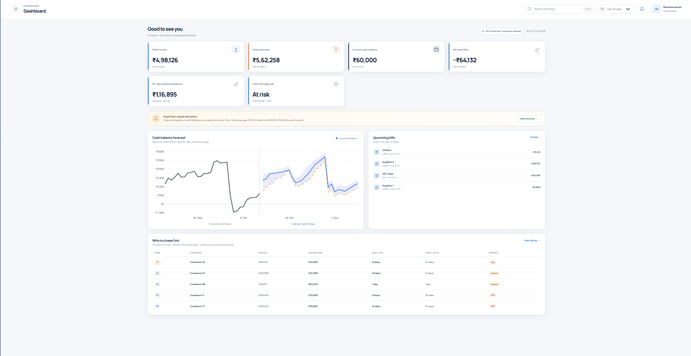
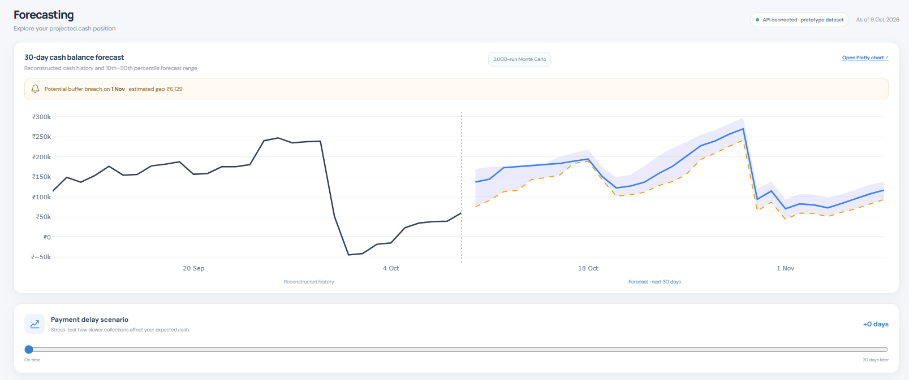
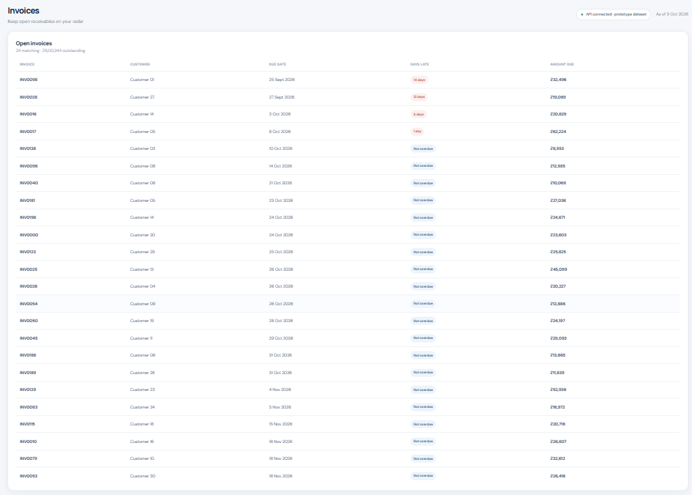

# 💰 BizCash 30

**Know your cash 30 days ahead — before a shortfall surprises you.**


📈 Forecast cash. ⚠️ Catch shortfalls early. 📞 Chase the right customers first.

> ⚠️ **Prototype data:** invoices, bills, expenses and balances in this repo are **synthetic**. Replace them with your own CSVs before relying on any result.

---

## ✨ Features

|   | Feature | Description |
|---|---------|-------------|
| 📊 | **30-day forecast** | Cash-flow and balance forecast for the next 30 days |
| 🎲 | **Monte Carlo scenarios** | 2,000 simulated 30-day cash paths, summarised as best (p90), expected (p50) and worst-case (p10) |
| 🚨 | **Shortfall alerts** | Warns when projected cash drops below a safe buffer |
| 📞 | **Collections queue** | Ranks which customers to chase first, based on learned payment behavior |
| 🧾 | **Invoices & bills** | Open invoices, upcoming bills and searchable transactions |
| 🗓️ | **Date filter** | View history for the last 30 days, 90 days, 6 months or 12 months |
| 📉 | **Damped-trend sales forecast** | Weekday-seasonal damped trend, backtested against a plain weekday average |
| 🔎 | **Backtesting** | Check forecast accuracy against past data |
| 📊 | **Plotly & Matplotlib charts** | Interactive Plotly forecast chart and static Matplotlib PNG |
| 📥 | **CSV import** | Upload your own data from Settings |
| ✅ | **Upload validation** | Checks columns, dates and amounts before a CSV is accepted |
| 💡 | **Shortfall advice** | Suggests which invoices to collect to close a projected gap |
| 🛟 | **Sample-data fallback** | Clearly labeled sample data if the API is offline |

---

## 🛠️ Tech stack

| Layer | Technology |
|-------|------------|
| 🎨 Frontend | React 18, HTML, CSS, JavaScript |
| ⚙️ Backend | Python 3, FastAPI, Uvicorn, pandas, NumPy |
| 📊 Charts | Plotly (dashboard and interactive chart), Matplotlib (static PNG) |
| 🗄️ Data | CSV files (database planned) |
| 🧠 Models | Monte Carlo simulation, weekday-seasonal damped trend, per-customer payment-delay model |
| 🧪 Testing | pytest |

---

## 🖼️ Screenshots

                                🏠 Dashboard



                                📈 Forecast



                                📞 Collections



---

## 🧩 How it works

1. 📤 Sales, invoices, bills, expenses and balance data are loaded from CSVs
2. 🧠 The engine learns how each customer pays (typical delays)
3. 📈 Daily sales are forecast with a weekday-seasonal damped trend
4. 🎲 Monte Carlo simulation runs 2,000 possible 30-day cash paths (random sales noise and random customer payment delays), where each day's closing cash = opening cash + money in − money out
5. 🚨 Paths are compared to the safe-cash buffer to raise shortfall alerts
6. 📞 Open invoices are ranked to show who to chase first
7. 📊 The React dashboard displays everything through the FastAPI endpoints

---

## 🚀 Getting started

Run the backend and frontend in two terminals.

### 🐍 Terminal 1 — Backend

```bash
cd backend
pip install -r requirements.txt
python make_data.py          # creates the 5 CSVs in backend/data/
uvicorn main:app --reload --port 8000
```

### ⚛️ Terminal 2 — Frontend

```bash
cd frontend
npm install
npm run dev
```

🌐 Open [http://localhost:5173](http://localhost:5173)

---

## 🧪 Tests & backtest

```bash
cd backend
pip install pytest
python -m pytest tests -q    # unit tests for forecast, alerts, ranking, validation
python backtest.py           # damped trend vs weekday-average baseline, 14 / 30 / 60 days
python charts.py             # saves a Matplotlib PNG to docs/images/
```

---

## 🗂️ Using your own data

Copy your sales file to `backend/data/sales_raw.csv` (Rossmann `train.csv`, or any CSV with `Date` and `Sales` columns), then run `python make_data.py` again. About 1 year of daily sales works well.

⚠️ Don't copy the raw file over `backend/data/sales.csv`. The engine needs the generated `sales.csv` with lowercase `date,amount` columns, otherwise loading fails with `Missing column provided to 'parse_dates': 'date'`.

📝 Invoices, bills, expenses and the opening balance are synthetic. You can also upload your own CSVs from **Settings** in the dashboard.

---

## 🔌 API

| Endpoint | Purpose |
|----------|---------|
| `GET /api/overview` | Summary, 365-day income/expense history, recent activity |
| `GET /api/forecast` | 30-day forecast and scenarios (`?runs=2000&extra_delay=0`) |
| `GET /api/chart/forecast` | Interactive Plotly forecast chart (HTML) |
| `GET /api/backtest` | Forecast accuracy against past data |
| `POST /api/upload/{table}` | Validate and upload a CSV to replace a data table (returns 400 with the reason if invalid) |

---

## ⚙️ Configuration

Tunables in `backend/engine.py`:

| Constant | Meaning |
|----------|---------|
| `BUFFER` | Minimum safe cash level (also shown on the dashboard) |
| `RUNS` | Number of simulations (2,000). The dashboard also sends `runs=` from `RUNS` in `frontend/src/App.jsx`, which overrides this default, so change both |
| `HORIZON` | Forecast length in days (30) |

---

## 📁 Project structure

```
BizCash-30/
├── backend/
│   ├── main.py          # FastAPI app
│   ├── engine.py        # forecasting, Monte Carlo, alerts, backtest
│   ├── make_data.py     # builds the 5 CSVs
│   ├── charts.py        # Plotly + Matplotlib charts
│   ├── validate.py      # CSV upload validation
│   ├── backtest.py      # forecast accuracy report
│   ├── tests/           # pytest tests
│   └── data/
├── frontend/
│   └── src/
│       ├── App.jsx      # dashboard
│       └── style.css
├── docs/images/         # Screenshots
└── README.md
```

---

## 🚧 Limitations

- 🏦 Cash-balance history is reconstructed from the latest balance and recorded cash movements, not real bank snapshots
- 🧾 Bills show in recent activity only once a payment-status field exists
- 📏 Only quote accuracy numbers that `/api/backtest` actually shows

---
## ☁️ Live demo

- 🌐 Frontend (Vercel): https://biz-cash-30.vercel.app
- ⚙️ API (Render): https://bizcash-30.onrender.com

The API runs on a free Render instance, so the first request after inactivity can take up to a minute. Until it responds, the dashboard shows labeled sample data.

---
